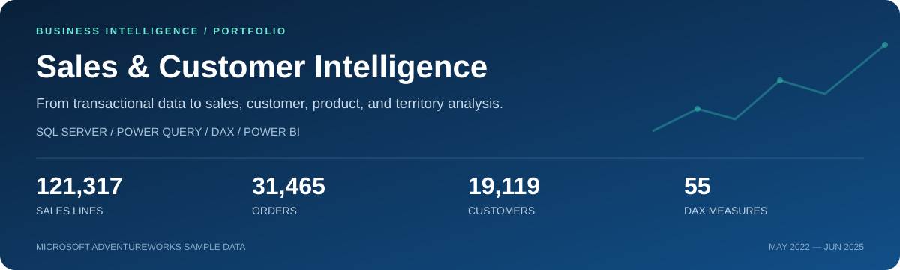
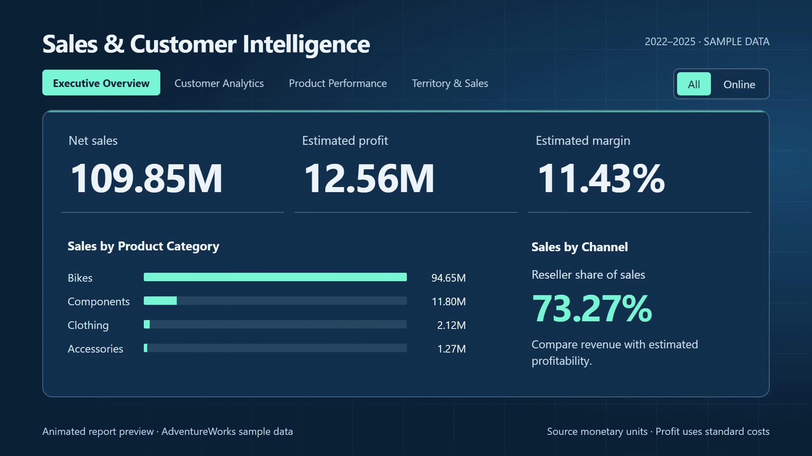
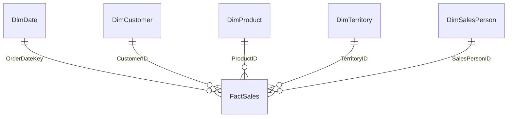

# Sales & Customer Intelligence



**An end-to-end business intelligence portfolio built with SQL Server, Power Query, DAX, and Power BI.**

This project transforms Microsoft AdventureWorks transactional data into a sales analytics model and a four-page interactive report. It connects revenue and estimated profitability with customer purchasing activity, product performance, and territory results, giving business users a consistent way to investigate where sales come from and how performance varies.

[Explore the report](Power%20BI/Sales_Customer_Intelligence.pbix) · [Report walkthrough](docs/REPORT_GUIDE.md) · [SQL pipeline](SQL/README.md) · [DAX measures](DAX/Measures.dax) · [Setup instructions](docs/SETUP.md)

## Project launch video

[](https://github.com/camelliapramanik/sales-customer-intelligence/raw/refs/heads/main/docs/assets/launch-video.mp4)

**[Watch the 22-second launch video](https://github.com/camelliapramanik/sales-customer-intelligence/raw/refs/heads/main/docs/assets/launch-video.mp4)** — a 1080p introduction to the sales overview, Online-channel comparison, customer activity, and SQL-to-Power BI workflow.

The video uses animated report previews built from the PBIX's imported AdventureWorks sample data. Profit figures are standard-cost estimates. Includes music; no narration.

## Business questions

- How are sales, estimated profit, order value, and channel mix changing?
- Which customers generate the most revenue, and how recently have they purchased?
- Which products drive sales volume and which generate stronger margins?
- How do territories and assigned salespeople compare, including comparable-period growth?

## Project at a glance

| Metric | Embedded report data |
| --- | ---: |
| Reporting period | May 30, 2022 – June 29, 2025 |
| Net sales | 109,846,380.90 |
| Estimated standard-cost profit | 12,557,724.05 |
| Estimated profit margin | 11.43% |
| Sales orders | 31,465 |
| Purchasing customers | 19,119 |
| Products sold | 266 |
| Units sold | 274,914 |
| Sales detail rows | 121,317 |

These are unfiltered aggregates independently calculated from the data stored in the PBIX. Monetary values use the sample database's source units; this project does not perform currency conversion. Report selections change the displayed results. See the [machine-readable snapshot](docs/metadata/snapshot.json) and [validation notes](docs/VALIDATION.md).

## Report experience

| Page | What it helps users investigate | Key visuals and metrics |
| --- | --- | --- |
| **Executive Overview** | Overall commercial performance | Sales, profit, margin, orders, customers, average order value, monthly trend, category sales, territory sales, channel mix |
| **Customer Analytics** | Customer value and purchasing activity | Customer base, active/inactive customers, repeat rate, new customer trend, top 10 customers by lifetime sales, purchase recency |
| **Product Performance** | Revenue concentration and product economics | Quantity, selling price, discount rate, top 10 products by sales/profit, subcategory performance, product detail table |
| **Territory & Sales Performance** | Geographic and salesperson performance | Territory sales, comparable YoY growth, regional channel mix, active salespeople, reseller sales per salesperson, ranking table |

The report includes page navigation, dropdown slicers, and an **About This Report** methodology page hidden from the normal page navigator. [Read the walkthrough](docs/REPORT_GUIDE.md) for filter behavior and a suggested demonstration sequence.

## Findings from the sample data

| Observation | Evidence | Business question to investigate next |
| --- | --- | --- |
| Sales are concentrated in bikes. | Bikes contribute **86.17%** of total sales. | How dependent is the sales mix on the bike category? |
| Revenue share and estimated margin tell different stories. | Reseller contributes **73.27%** of sales at **0.59%** estimated margin; Online contributes **26.73%** at **41.15%**. | How do discounts, product mix, and the standard-cost assumptions explain the gap? |
| A small category has a stronger estimated margin. | Accessories contribute **1.16%** of sales at **49.87%** estimated margin. | Are there relevant cross-sell opportunities to investigate? |
| Sales leadership differs from margin leadership. | Southwest leads sales at **24.18M**; Australia has **10.66M** in sales and **33.57%** estimated margin. | What differs in each territory's channel and product mix? |
| Recent activity is a subset of the historical customer base. | As of June 29, 2025, **5,111** customers are active and **14,008** inactive under the 90-day rule. | Which previously valuable customers merit further retention analysis? |

These observations describe a sample dataset. They are not claims of realized business impact, causal findings, or validated marketing outcomes.

## Architecture and modeling


The model uses **one sales fact table and five dimensions**, connected by five active, single-direction, many-to-one relationships. Sales are modeled at **one row per sales order detail**, allowing order and customer counts to use distinct IDs instead of overcounting line items.



Design choices include store-first customer classification, an explicit unassigned salesperson key, sold-product and purchasing-customer dimensions, and historical standard-cost lookup using `OUTER APPLY`. [Model and data dictionary](docs/DATA_MODEL.md)

## Metric methodology

- **Sales:** discounted line revenue, excluding order tax and freight.
- **Estimated profit:** line revenue less quantity multiplied by the latest standard cost whose start date is on or before the order date. Current product cost is a fallback when no earlier cost exists. Cost-history end dates are not tested in the original logic.
- **Customer activity:** active means last purchase was at most 90 days before the selected analysis date; inactive means more than 90 days. The analysis date is the maximum selected calendar date, not the system date.
- **Customer lifetime metrics:** accumulated through the analysis date, with date filters replaced and other business filters retained.
- **Comparable YoY:** compares overlapping available periods between a selected year and its predecessor. When multiple years are selected, the measure uses the latest selected year.

The [metric catalog](docs/METRICS.md) explains these definitions and links to all 55 extracted measures. Profit is a standard-cost estimate, not accounting net income. Independent line rounding means summed profit need not equal summed sales minus summed cost exactly.

## Repository structure

```text
Sales_Customer_Intelligence_Portfolio/
├── README.md
├── SQL/
│   ├── README.md
│   ├── 01_Data_Exploration.sql
│   ├── 02_Analytics_Schema_and_Date.sql
│   ├── 03_Dimension_Views.sql
│   ├── 04_Fact_Sales_View.sql
│   └── 05_Data_Validation.sql
├── Power BI/
│   ├── Sales_Customer_Intelligence.pbix
│   └── Power Query/                 # Extracted M queries
├── DAX/Measures.dax                 # All original measure expressions
├── data/README.md                   # Official sample download and provenance
├── docs/
│   ├── SETUP.md
│   ├── REPORT_GUIDE.md
│   ├── DATA_MODEL.md
│   ├── METRICS.md
│   ├── VALIDATION.md
│   ├── PUBLISHING.md
│   ├── assets/                      # Portfolio banner, launch video and cover
│   └── metadata/                    # Extracted schema, relationships and results
└── tools/                           # Optional repeatable PBIX documentation export
```

## Run the project

1. Download the **AdventureWorks2025 OLTP** backup from [Microsoft's sample database documentation](https://learn.microsoft.com/en-us/sql/samples/adventureworks-install-configure) and restore it on a compatible SQL Server instance.
2. In SSMS, run SQL scripts **02 → 03 → 04 → 05**. Script 01 is optional source exploration. The build creates the `analytics` schema, date table, and six views.
3. Open [Sales_Customer_Intelligence.pbix](Power%20BI/Sales_Customer_Intelligence.pbix) in a current compatible Power BI Desktop version.
4. For a refresh, update the existing SQL Server connection from `localhost` to your instance, authenticate locally, and refresh the model. Keep the existing table and view names.
5. Compare unfiltered totals with the reference snapshot and explore the four pages.

The PBIX includes imported data for inspection before a refresh. [Detailed setup and troubleshooting](docs/SETUP.md)

## Quality and portfolio scope

The embedded data passed duplicate-key and dimension-match checks. SQL has been separated into source exploration, date setup, dimension views, the final fact view, and validation. Original PBIX measures and Power Query expressions are exported so reviewers can inspect the implementation without opening a binary file.

Known limitations are documented, including duplicate customer display names, partial calendar years, the historical-cost fallback, and diagnostic measures retained in the PBIX. SQL runtime execution and visual rendering in Power BI Desktop were not performed during repository preparation. [Validation and improvement opportunities](docs/VALIDATION.md)

**Skills demonstrated:** relational data exploration, T-SQL joins and as-of cost selection, dimensional modeling, Power Query transformations, DAX filter context, customer recency analysis, time intelligence, and business-focused report design.

## Data attribution

Source data comes from Microsoft's AdventureWorks sample database. This is an independent portfolio project using sample data; it is not an employer or client engagement. The database backup is intentionally excluded from Git. [Data provenance](data/README.md) · [GitHub publishing guide](docs/PUBLISHING.md)
